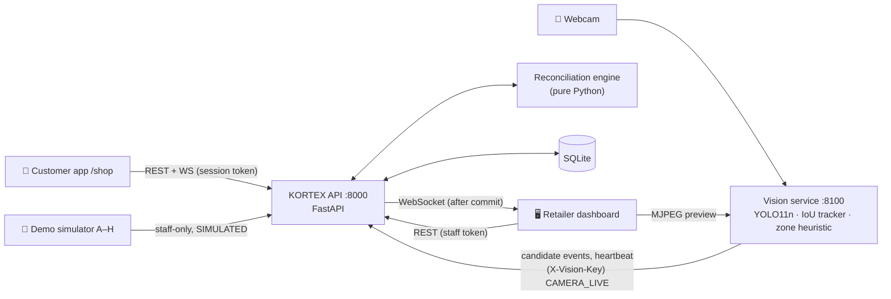

<div align="center">

# KORTEX AI

**Scan It. Pick It. Verify It.**

Uncertainty-aware scan-and-go verification with a self-correcting virtual cart.
Everseen Computer Vision AI Hackathon · **Problem Statement 2 — Mobile Scan and Go: Checkout-Anywhere Loss Prevention**

**Team CIA TRIAD** — Abhijeet · Shreejoy · Himanshu

</div>

### 🚀 Live Demo

| | URL |
|---|---|
| 🖥️ Retailer dashboard | **https://kortex-ai-one.vercel.app** |
| 📱 Customer app | **https://kortex-ai-one.vercel.app/shop** |
| 🔌 API health | https://kortex-ai.onrender.com/api/health |

**Quick start for judges:** Open the dashboard → sign in as `manager` / `admin123` → click **Start Demo** → pick **Scenario A** (normal purchase) to see the full scan-verify-checkout flow in under 60 seconds. Try Scenarios B, C, and G for edge cases.

> **Prototype notice.** KORTEX is a hackathon prototype for demonstration. Payment and the
> exit gate are **simulated**. The confidence thresholds are untuned demo defaults. Nothing
> here is certified or production-ready.

---

## 1. What it is

KORTEX connects four parts of a scan-and-go store:

| | Part | What it does |
|---|---|---|
| 📱 | **Customer app** (`/shop`) | Shoppers scan real barcodes (EAN-13/8, UPC-A/E) with a phone or laptop camera and see their cart, any alerts, and an itemised bill. |
| 🎥 | **Vision service** | A local webcam, YOLO11n, an IoU tracker and a shelf-zone heuristic produce *candidate* pickup/return events. |
| 🧠 | **Reconciliation engine** | Correlates scans with physical evidence and decides whether to *match*, *wait*, *ask*, or *escalate*. |
| 🖥️ | **Retailer dashboard** | Live monitoring, sessions, discrepancies, product catalogue, audit trail and settings. |

It balances three goals:

* **Security:** detect possible missed scans and wrong-product scans.
* **Customer experience:** never accuse anyone; let shoppers fix honest mistakes themselves.
* **Operations:** automate the routine and send only genuine exceptions to staff.

### Differentiators

1. **Uncertainty-aware decisions.** Model confidence and reconciliation confidence are kept
   separate. Every decision stores the evidence factors behind it (track stability, weight
   sensor, class-level vs SKU-level recognition, camera gaps).
2. **Self-correcting cart.** A mismatch becomes a one-tap confirmation for the customer
   ("I have the chocolate"). The cart changes only after confirmation, using catalogue
   prices, and the original evidence is preserved.
3. **Grace-window matching.** A pickup without a scan is never flagged immediately.
   KORTEX waits for a late scan (default 15 s) and recognises returns to the shelf.
4. **Backend-enforced checkout.** One authoritative eligibility service with an
   idempotent, itemised authorisation record. The frontend never decides.
5. **Honest provenance.** `LIVE CAMERA`, `SIMULATED`, `MANUAL` and `CUSTOMER APP` events
   are stored and displayed distinctly. No facial recognition, no person tracking, and no
   video saved to disk.

## 2. Architecture



The full design (sequence diagram, state machines, timing windows, confidence policy,
security model and deployment path) is in **[docs/architecture.md](docs/architecture.md)**.
The REST API is self-documented at **http://localhost:8000/docs** (OpenAPI/Swagger).

### Data flow in one sentence

A scan creates one `ScanEvent` per cart unit. A camera pickup creates a `VisionEvent` that
either matches an unmatched scan one-to-one or, after the grace window, becomes a
`ReconciliationResult` plus (if warranted) a `Discrepancy`. Customer or staff actions append
`ResolutionAction`s and correct the cart. Every step writes an append-only `AuditEvent` and a
post-commit WebSocket notification.

## 3. Tech stack

| Layer | Technology (versions installed and tested) |
|---|---|
| Web | React 19.3, TypeScript 6 (strict), Vite 8, Tailwind CSS 4, shadcn-style components on Radix UI, Lucide icons, Recharts 3, React Router 8, TanStack Query 5, Zod 4, Sonner, ZXing (`@zxing/browser`) |
| API | Python 3.11/3.12, FastAPI 0.143, Pydantic 2.14, SQLAlchemy 2.1, SQLite (WAL), WebSockets, Pytest 9 + HTTPX, Ruff |
| Vision | Python 3.12, OpenCV 5.0, Ultralytics 8.4 (YOLO11n, COCO), PyTorch 2.14 CPU, custom IoU tracker, FastAPI MJPEG server |
| Tooling | Git, `.env` configuration, pinned `requirements.txt` + full `requirements.lock`, `package-lock.json`, PowerShell scripts |

## 4. Repository layout

```
kortex/
├─ apps/web/                 React app (dashboard + /shop customer app)
│  └─ src/{app,components/ui,components/status,layouts,features/*,hooks,lib,types,test}
├─ services/api/             FastAPI backend
│  ├─ app/{api/routes,core,db,models,schemas,services,websocket}
│  │  └─ services/reconciliation.py   ← pure decision engine
│  └─ tests/                 83 backend tests
├─ services/vision/          Webcam + YOLO + tracker + zone heuristic
│  ├─ kortex_vision/
│  └─ tests/                 13 vision tests
├─ scripts/                  setup / start / seed / test (PowerShell)
├─ docs/architecture.md
├─ data/                     SQLite database (git-ignored)
└─ .env.example
```

## 5. Setup

### Prerequisites

* **Windows 10/11** (the scripts are PowerShell; the code is cross-platform)
* **Node.js 20+** (tested with 24.11)
* **Python 3.11+** or **[uv](https://docs.astral.sh/uv/)**. The setup script uses `uv` to create
  isolated CPython 3.12 environments and installs `uv` for you if it's missing.
* A webcam (optional; simulation mode works without one)

### One command

```powershell
powershell -ExecutionPolicy Bypass -File scripts\setup.ps1          # everything
powershell -ExecutionPolicy Bypass -File scripts\setup.ps1 -SkipVision   # skip the ~1 GB PyTorch download
```

The script:

1. creates `.env` from `.env.example` with **freshly generated** secrets
   (the demo staff password is set to `kortex-demo-2026`; edit `.env` *before seeding* to change it);
2. creates `services/api/.venv` and `services/vision/.venv` and installs pinned dependencies;
3. downloads the YOLO11n weights (5.4 MB) into `services/vision/models/`;
4. runs `npm install` in `apps/web`;
5. creates the schema and seeds the database **idempotently** (re-running never duplicates rows).

<details>
<summary>Manual setup (any OS)</summary>

```bash
cp .env.example .env            # then replace the change-me values
# API
cd services/api && uv venv --python 3.12 .venv && uv pip install --python .venv/bin/python -r requirements.txt
.venv/bin/python -m app.db.seed
# Vision (optional)
cd ../vision && uv venv --python 3.12 .venv
uv pip install --python .venv/bin/python --index-strategy unsafe-best-match -r requirements.txt
curl -L -o models/yolo11n.pt https://github.com/ultralytics/assets/releases/download/v8.3.0/yolo11n.pt
# Web
cd ../../apps/web && npm install
```
</details>

### Environment variables

| Variable | Purpose |
|---|---|
| `KORTEX_DATABASE_URL` | SQLite file (default `./data/kortex.db`, relative to repo root) |
| `KORTEX_SECRET_KEY` | Signs staff tokens. **Must be long and random.** |
| `KORTEX_VISION_API_KEY` | Shared key the vision service sends as `X-Vision-Key` |
| `KORTEX_SEED_STAFF_PASSWORD` | Password given to the seeded `manager` / `attendant` accounts on first seed |
| `KORTEX_CORS_ORIGINS` | Allowed browser origins |
| `VISION_CAMERA_INDEX` / `VISION_CAMERA_URL` | Webcam index, or an RTSP/HTTP stream URL |
| `VISION_PROCESS_FPS`, `VISION_MODEL`, `VISION_ZONE_ID`, `VISION_PORT` | Vision tuning |

`.env` is git-ignored. Only placeholders live in `.env.example`.

### Database

The schema is created with SQLAlchemy `create_all` on API start (non-destructive).
`scripts\seed.ps1` adds the store, the two staff accounts, **5 demo products**, the camera
zone `SHELF-A1`, and **18 labelled historical demo sessions**. These were produced by running
the real pipeline and then time-shifting, so the 7-day dashboard chart has genuine rows.
Pass `-NoHistory` to skip them. Data persists across restarts in `data/kortex.db`.

| SKU | Product | Barcode (EAN-13) | Price | Detector class |
|---|---|---|---|---|
| BEV-COLA-500 | Kortex Cola 500 ml | 8901001000018 | ₹40.00 | `bottle` |
| CNF-CHOC-100 | Dark Chocolate Bar 100 g | 8901001000025 | ₹60.00 | — (SKU model / simulation) |
| FRT-BANANA-6 | Robusta Bananas (6 pcs) | 8901001000032 | ₹55.00 | `banana` |
| STN-NOTE-A5 | Ruled Notebook A5 | 8901001000049 | ₹75.00 | `book` |
| HOM-MUG-350 | Ceramic Coffee Mug 350 ml | 8901001000056 | ₹199.00 | `cup` |

> Product images are original placeholder illustrations, not photographs of real products.
> To scan with a real camera, print or display these barcodes (any EAN-13 generator works),
> or add your own products with their real barcodes in **Product Catalogue**.

## 6. Running

```powershell
scripts\start-all.ps1              # API + web + vision, each in its own window
scripts\start-all.ps1 -NoVision    # without the webcam service
# or individually:
scripts\start-api.ps1      # http://localhost:8000   (Swagger: /docs)
scripts\start-web.ps1      # http://localhost:5173
scripts\start-vision.ps1   # http://127.0.0.1:8100   (-Camera 1 to pick another webcam)
```

| Interface | URL |
|---|---|
| Retailer dashboard | http://localhost:5173/overview (sign in as `manager` or `attendant`) |
| Customer app | http://localhost:5173/shop |
| API docs | http://localhost:8000/docs |
| Vision status / preview | http://127.0.0.1:8100/status · `/stream.mjpg` (shown inside **Live Monitoring**) |

The `manager` can change reconciliation thresholds. The `attendant` can do everything else.

### Deploying online (Render)

Both the API and the web app deploy to **Render** via the included Blueprint (`render.yaml`).
This keeps everything on one platform and — critically — preserves **WebSocket** support for
the Live Monitoring page's real-time event stream. The vision service stays on the demo laptop.
Step-by-step guide: **[docs/deploy.md](docs/deploy.md)**.

### Using a phone

Browsers only allow camera access over **HTTPS** (or on `localhost`). To scan from a phone on the same Wi-Fi:

```powershell
scripts\start-web.ps1 -Https       # or: scripts\start-all.ps1 -Https
```

Then open `https://<laptop-LAN-IP>:5173/shop` on the phone. Vite prints the address as
"Network". Accept the self-signed-certificate warning once. The dev server proxies `/api`,
`/ws` and `/vision`, so nothing else needs to be exposed. If Windows Firewall prompts,
allow Node.js on **private** networks.

On a laptop, `/shop` uses the webcam for barcode scanning. If the camera is denied, missing,
or blocked by an insecure context, the app explains why and offers **Type code** and
**Find item** fallbacks. Unknown barcodes are never added to the cart.

### Using the webcam for shelf vision

1. `scripts\start-vision.ps1` (the camera indicator in **Live Monitoring** turns to `LIVE CAMERA`).
2. In **Live Monitoring**, pick the session to watch (camera card, *Watching*), or click **New demo session**.
3. Place a bottle, cup, banana or book inside the highlighted **left 42 % of the frame**
   (the shelf zone). Wait about a second, then lift it out of the zone and hold it outside.
   The service emits a **candidate PICKUP**; moving it back emits a **candidate RETURN**.
4. Scan the matching product in the customer app within the grace window to see **MATCHED**,
   or don't, to see a candidate missed-scan prompt.

Boxes in the preview come only from real model output in that frame. Frames stay in memory
and are never written to disk.

## 7. Jury demo scenarios

Click **Start Demo** (top bar) → choose a scenario. Each run creates a **new labelled demo
session** (existing data is untouched) and executes step by step through the real API service
layer, database, reconciliation engine and WebSockets. The run panel in **Live Monitoring**
shows progress, a presenter hint, and an **Open customer app** link for that session.

* **Fast-forward** skips the real 15 s grace window. The skip is recorded in the audit trail.
* **Autoplay** also performs the presenter steps. Otherwise the run pauses so you can act as
  the customer (phone) or staff (Discrepancies page). **Autoplay rest** resumes it.

| | Scenario | What happens | What to show |
|---|---|---|---|
| A | Normal purchase | Cola scanned, weight drop, camera pickup → **MATCHED** | Customer checks out; verification 1/1 |
| B | Possible missed scan | Chocolate pickup with no scan → after grace, **missed-scan candidate** | Customer taps *Yes, add Dark Chocolate* |
| C | Product mismatch | Scanned Cola ₹40, camera sees Chocolate ₹60 → **wrong-product candidate**; cart stays ₹40 | Customer confirms → ₹60; checkout was blocked before |
| D | Pickup then return | Notebook picked up and returned (same track) → no alert, informational record | Session → Camera events: `RETURNED` |
| E | Uncertain vision | Occluded low-confidence pickup → **customer check**; contradicted by the shelf scale → **staff review** | Two different routes, no accusation |
| F | False positive dismissed | Customer disputes ("my scan is correct") → staff dismisses with a reason | Discrepancies → *Dismiss false positive*; cart unchanged |
| G | Checkout blocked | Unresolved missed-scan candidate → checkout attempt gets **HTTP 409** with reasons | Customer app shows actionable blockers |
| H | Successful checkout | Mismatch confirmed, checkout authorised, itemised bill, simulated exit | Receipt + audit trail |

The **Simulate** card in Live Monitoring injects individual labelled events (pickup/return
with any confidence, simulated scans; under *More options*: track ID, uncertainty reason,
weight readings, camera drop/reconnect, *Decide now*) into the same pipeline.

## 8. Tests

```powershell
scripts\test-all.ps1
```

Results **observed on the development machine** (Windows 11, 10 Oct 2026):

| Suite | Command | Result |
|---|---|---|
| API (engine unit tests + API integration + all 8 scenarios) | `pytest` | **83 passed** |
| API lint | `ruff check` | clean |
| Vision (tracker, zone heuristic, event adapter) | `pytest` | **13 passed** |
| Web typecheck (strict) | `tsc -b` | clean |
| Web lint | `eslint` | clean |
| Web component tests (customer correction flow, session start, checkout denial, staff reason requirement, money formatting) | `vitest` | **6 passed** |
| Web production build | `vite build` | succeeds |

Backend coverage includes barcode check digits, product validation (duplicate barcode/SKU,
invalid price, missing fields), integer-paise totals, session tokens, scan idempotency,
debounce, soft duplicates, one-to-one matching, missed-scan and wrong-product candidates,
duplicate and idempotent camera events, pickup→return, low confidence, class-level mapping,
contradicting sensor evidence, camera disconnect, late scans, customer correction, staff
dismissal/escalation, audit preservation, checkout denial, authorisation with catalogue
prices, repeated checkout idempotency, simulated exit, WebSocket session isolation, and
rolled-back transactions not notifying clients.

Manual end-to-end checks were also run in Microsoft Edge (via Playwright) against the
running services: scenario C on a phone viewport (alert → blocked checkout → correction →
₹60 bill → receipt → exit), scenario F with a staff dismissal in the UI, and a fresh customer
session with manual entry, an unknown barcode, a catalogue pick, quantity changes and
checkout. The live webcam stream was confirmed rendering in Live Monitoring.

## 9. Troubleshooting

| Problem | Fix |
|---|---|
| `pip`/`uv` SSL errors (`CERTIFICATE_VERIFY_FAILED`) | Antivirus HTTPS scanning or a proxy. The scripts pass `--native-tls` so uv trusts the Windows store. With pip, use `pip install truststore` then `--use-feature=truststore` (pip ≥ 24.2 does this by default). |
| `OSError: [WinError 1114] … c10.dll` when importing torch | Your Python (e.g. Anaconda) ships an old MSVC runtime. Use the uv-managed CPython the setup script creates. |
| Dashboard shows "Reconnecting" | The API isn't running on :8000, or you opened the API port directly instead of :5173. |
| Customer scanner: "Camera needs a secure connection" | Use `start-web.ps1 -Https` on phones; `localhost` works on the laptop. |
| Camera permission denied | Re-enable it in the browser's site settings, then **Retry camera**. |
| Scanner says "Camera is being used by another app" | Windows allows one app per webcam. The vision service is using it: **Live Monitoring → Release webcam**, then **Retry camera** (or scan with a phone). |
| Barcode won't read on a laptop webcam | Fill the guide box with the barcode, 10–20 cm away, steady and well lit. Fixed-focus webcams struggle with tiny codes; a phone camera is more reliable. |
| Live Monitoring: "Vision service not running" | Run `scripts\start-vision.ps1`; check `http://127.0.0.1:8100/status`. Close other apps using the webcam. |
| Vision events are "Unassigned" | No session is bound to zone `SHELF-A1`. Pick one in Live Monitoring. |
| "Invalid username or password" | The password is `KORTEX_SEED_STAFF_PASSWORD` from the `.env` used at **first** seed. Delete `data/kortex.db` and reseed to change it. |
| Port already in use | Stop the other process or change ports (`VISION_PORT`; Vite `--port`). |

## 10. Real vs simulated

| Capability | Status |
|---|---|
| Barcode scanning (ZXing, phone/laptop camera), manual entry, catalogue fallback | ✅ Real |
| Sessions, cart, catalogue prices, reconciliation, discrepancies, corrections, audit, WebSockets | ✅ Real (persisted) |
| Checkout eligibility and itemised bill | ✅ Real backend logic |
| Payment, exit gate | 🧪 **Simulated** (clearly labelled) |
| Webcam capture, YOLO detection, tracking, zone heuristic → candidate events | ✅ Real, but **class-level only** (see limitations) |
| SKU-level recognition (e.g. "Dark Chocolate Bar") from the camera | 🧪 Only via simulated events or a future custom model |
| Shelf-weight sensor | 🧪 Simulated (`SENSOR_SIMULATED`); live endpoint ready for ESP32 + HX711 |
| Demo scenarios A–H | 🧪 Simulated inputs, real processing |
| Historical dashboard data | 🧪 Seeded demo sessions (flagged `is_demo`) |

## 11. Vision limitations (please read)

* The pretrained YOLO11n model knows **80 generic COCO classes**. It recognises "bottle",
  "cup", "banana", "book" and so on, **not specific SKUs**. KORTEX maps a class to a catalogue
  product only when exactly one active product uses that class, labels the event
  `CLASS`-level, and penalises its reconciliation confidence. If several products share a
  class, the event becomes *uncertain* rather than being guessed.
* Pickup/return inference is a **bounding-box heuristic** over a fixed zone. It is not action
  recognition and cannot tell *who* moved an item. Shopper association is an explicit
  zone→session binding in this prototype.
* Accuracy has **not** been benchmarked. Lighting, occlusion and camera angle matter a lot.
  The thresholds are untuned demo defaults.
* A missing camera event never proves nothing was taken, and a camera event without a scan
  is only a candidate. The system asks; it does not accuse.
* Measured throughput on the development laptop (CPU only): about 29 ms per YOLO11n
  inference at 480 px, with the full pipeline running at roughly 4–6 FPS.

## 12. Security & privacy

* Server-side validation everywhere. Client prices and totals are never trusted.
* Staff: PBKDF2-hashed passwords and signed, expiring tokens. Customers: per-session random
  tokens (only the hash is stored). Vision: shared key. Simulator: staff-only.
* No facial recognition, no person tracking (people are excluded from detection classes),
  no video stored, and no personal data collected (shoppers are "Guest 1234").
* Append-only audit trail. Corrections never overwrite evidence.
* **Local-demo limitations:** tokens live in `localStorage`; there is no HTTPS termination
  beyond the dev certificate, no rate limiting, and no key rotation. Do not expose this
  prototype to the internet.

## 13. Future work

* Fine-tune a SKU-level detector on store imagery (drop-in `Detector` implementation).
* ByteTrack/BoT-SORT tracking and multi-camera zone handoff.
* Privacy-preserving shopper association (smart basket or cart tags) instead of manual zone binding.
* Live ESP32 + HX711 shelf scales with calibration UI.
* PostgreSQL + Alembic, background job queue, RTSP camera fleet management.
* Calibrate thresholds on labelled store data and report precision/recall honestly.
* Real payment integration and an exit-gate device.

## 14. Licences & credits

YOLO11n weights © Ultralytics (AGPL-3.0). Fonts: Inter and JetBrains Mono (OFL, self-hosted
via Fontsource). Icons: Lucide (ISC). All product art and the KORTEX mark are original.
