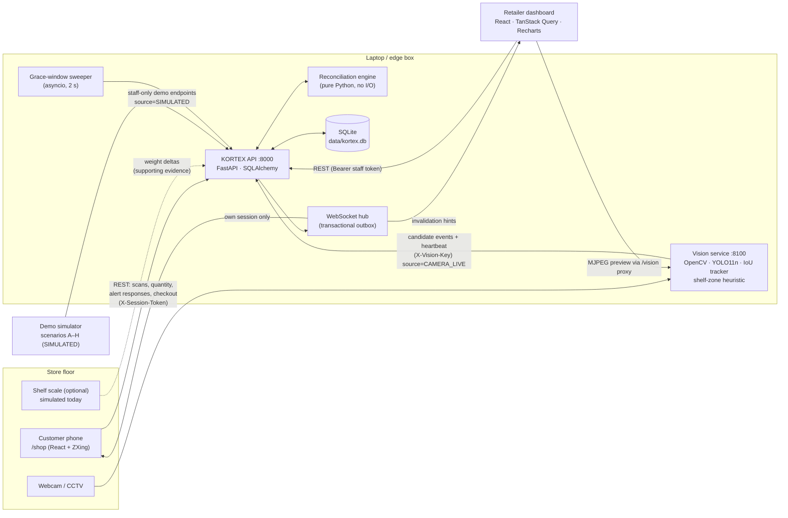
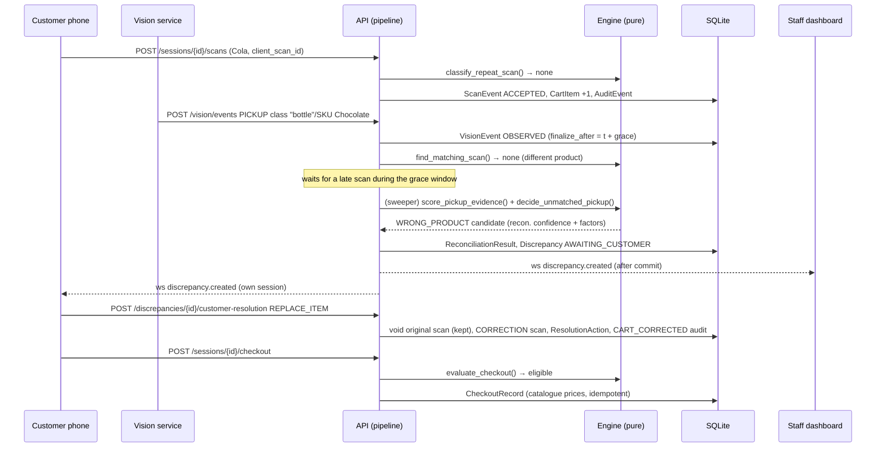

# KORTEX AI — Architecture

## System overview



The browser only ever talks to the Vite dev server origin, which proxies
`/api`, `/ws` and `/vision`. That keeps CORS simple and lets a phone on the same
Wi-Fi use one HTTPS origin.

## Data flow: one physical interaction



## Components

| Component | Responsibility | Key files |
|---|---|---|
| Reconciliation engine | Matching, evidence scoring, unmatched-pickup decisions, checkout eligibility. Pure functions over immutable views; unit-tested without a DB. | `services/api/app/services/reconciliation.py`, `policy.py` |
| Pipeline | Applies engine decisions to persisted state; single entry point for scans, camera events (live or simulated) and sensor readings. | `services/api/app/services/pipeline.py` |
| Discrepancies / resolutions | Idempotent creation (dedupe keys), audited state transitions, customer and staff actions, self-correcting cart. | `discrepancies.py`, `resolutions.py`, `cart.py` |
| Checkout | One authoritative eligibility service; idempotent authorization; simulated payment and exit. | `checkout.py` |
| Real-time hub | Messages enqueued on the DB session and published only after commit. Clients refetch REST state. | `app/websocket/hub.py` |
| Vision service | Webcam capture + reconnection, YOLO adapter, IoU tracker, shelf-zone heuristic, event publisher, MJPEG preview. | `services/vision/kortex_vision/*` |
| Web app | Retailer dashboard + customer app sharing one design system and one API client. | `apps/web/src/*` |

## State machines

**Camera event (`VisionEvent.state`)**

```
PICKUP:  OBSERVED ──match──────────────▶ MATCHED ──return──▶ RETURNED
            │
            ├─ grace expired / checkout ─▶ CANDIDATE_DISCREPANCY ─▶ RESOLVED
            ├─ below noise floor ────────▶ LOW_SIGNAL
            └─ return observed ──────────▶ RETURNED
any:     duplicate (same track ± window) ▶ DUPLICATE
         no session bound to zone ─────▶ UNASSIGNED
```

**Discrepancy**

```
AWAITING_CUSTOMER ⇄ AWAITING_STAFF → ESCALATED
        │                 │              │
        └──────► RESOLVED / DISMISSED ◄──┘     (terminal; history kept in ResolutionAction)
```

**Session:** `ACTIVE → CHECKOUT_AUTHORIZED → EXITED` (or `CANCELLED`). The cart is
locked once checkout is authorized.

## Matching and timing (defaults; configurable on the Settings page)

| Policy | Default | Meaning |
|---|---|---|
| `scan_debounce_ms` | 1500 | Repeated scanner callback for the same barcode is ignored. |
| `duplicate_scan_window_s` | 8 | A deliberate second scan is accepted but the customer confirms the quantity. |
| `scan_lead_s` | 20 | A scan up to 20 s *before* a pickup can match it. |
| `scan_grace_s` | 15 | KORTEX waits 15 s *after* a pickup for a scan before raising anything. |
| `return_window_s` | 180 | A return cancels a pickup up to 3 min earlier (same track preferred). |
| `vision_dedupe_window_s` | 4 | Same track + same event type inside 4 s is one event. |
| `noise_floor` / `uncertain_threshold` / `mismatch_threshold` | 0.20 / 0.55 / 0.70 | Reconciliation-confidence bands (log only / ask to verify / allowed to propose a swap). |

Requesting checkout counts as "shopping finished", so pending observations are
finalised immediately instead of waiting out the grace window.

**One-to-one guarantees:** a scan carries a unique `matched_vision_event_id`; an
event carries `matched_scan_id`. Matching only considers unmatched scans.
Duplicate camera events are suppressed by track and time, and external
`event_id`s make producer retries idempotent. Scans carrying a client-generated
`client_scan_id` are idempotent too.

## Confidence

* **Model confidence** is what the detector reported.
* **Reconciliation confidence** starts from it, then adds or subtracts explicit, recorded
  factors: stable track (+0.10), class-level-only recognition (−0.10), weight agrees
  (+0.15), weight contradicts (−0.30), weight differs (−0.05), recent camera reconnect
  (−0.10). Every decision stores its factor list and a snapshot of the policy used.

These numbers are prototype heuristics for a controlled demo. They are **not**
calibrated or scientifically validated.

## Security model (local prototype)

| Actor | Mechanism |
|---|---|
| Staff | PBKDF2-SHA256 password hashes; HMAC-SHA256 signed expiring bearer tokens; manager-only policy changes. |
| Customer | Random per-session token (only its SHA-256 hash is stored); required for every customer action and for the customer WebSocket, which only receives that session's events. |
| Vision service | Shared `X-Vision-Key`. Only this endpoint can create `CAMERA_LIVE` events. |
| Simulator | Staff-authenticated demo endpoints; everything stored as `SIMULATED`. |

Prices and totals always come from the catalogue on the server. Client prices are
never accepted. CORS is restricted to configured origins. Limitations: tokens are kept
in `localStorage` and there is no rate limiting, HTTPS termination, or key rotation.
That is acceptable for a local demo, not for production.

## Deployment path beyond the prototype

* **Cameras:** the vision service reads any OpenCV source. A retailer's CCTV can
  be connected if it exposes an accessible stream (RTSP/ONVIF/HTTP) by passing a
  stream URL instead of a device index. KORTEX cannot be installed *inside* an
  arbitrary CCTV camera. Compatibility depends on the camera's video interfaces,
  and inference needs compute: an in-store edge box (e.g. a mini PC or Jetson-class
  device) per few cameras.
* **SKU recognition:** replace `YoloDetector` with a model fine-tuned on the
  store's own product images. It implements the same `Detector` protocol, and
  products already carry a `model_class` mapping.
* **Shopper association:** the prototype binds a camera zone to one session
  explicitly. A real store needs privacy-preserving association (e.g. basket/cart
  tags, zone handoff), still without facial recognition.
* **Weight sensors:** an ESP32 + HX711 bridge can POST to
  `/api/vision/sensor-events` with calibration metadata. Weight remains supporting
  evidence only.
* **Data:** move from SQLite to PostgreSQL and from `create_all` to Alembic migrations.
